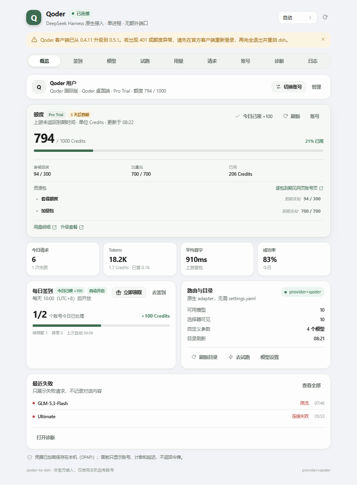
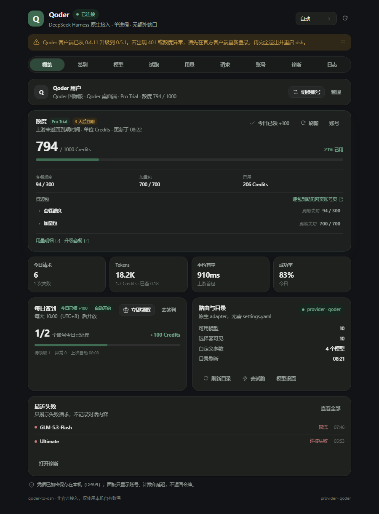
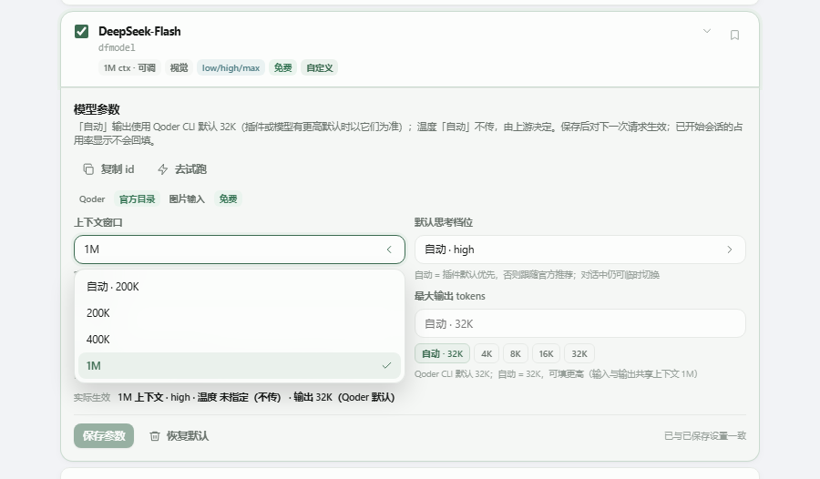
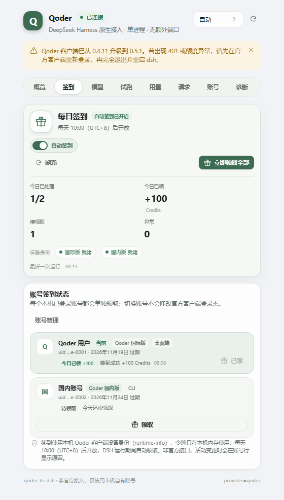
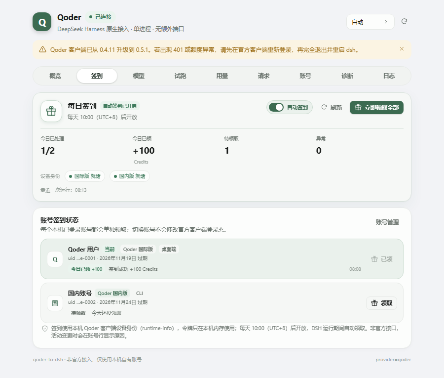
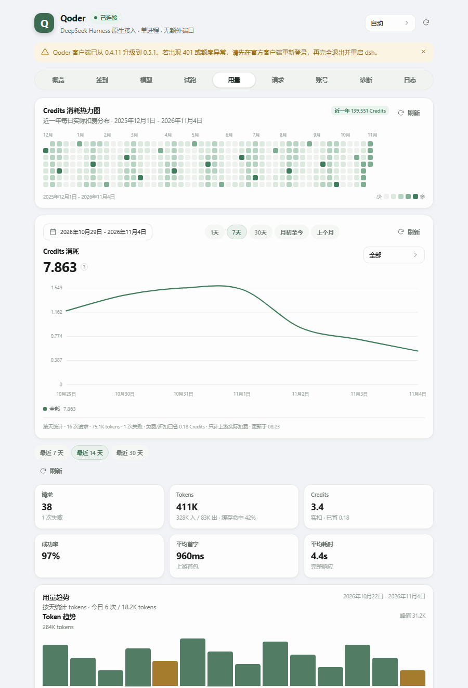
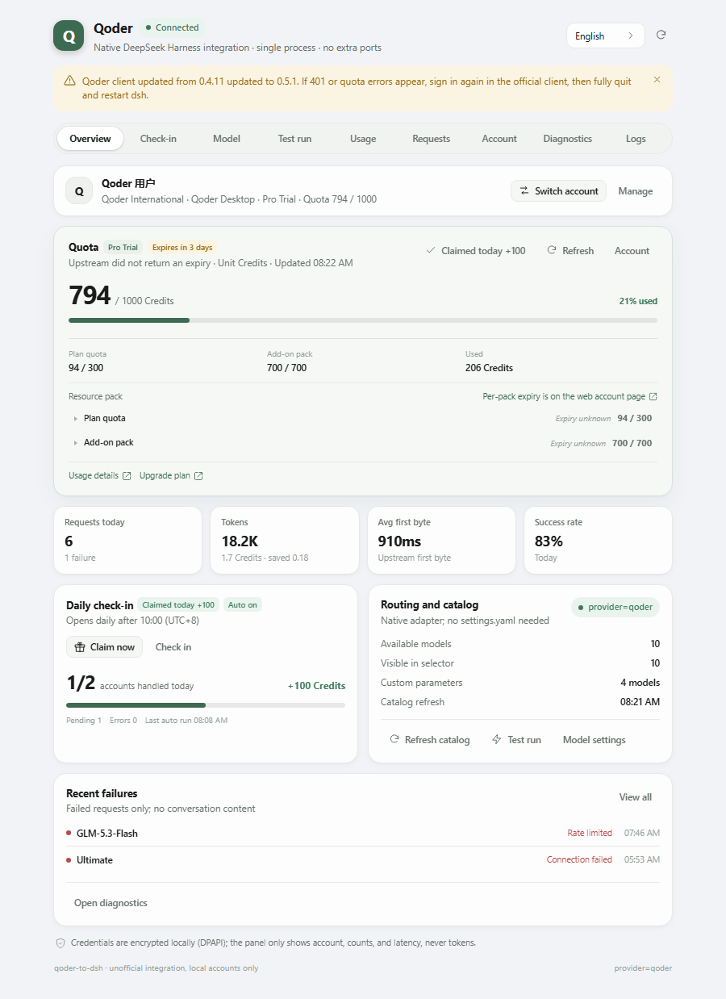
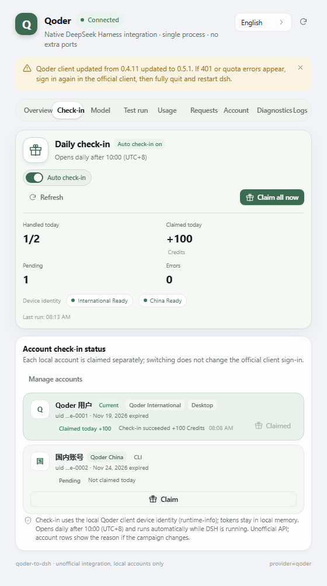

# qoder-to-dsh

把 **Qoder** 的模型额度原生接进 **DeepSeek Harness (DSH)**。当前版本 **1.7.3**。

这是一个纯 DSH 插件：没有本地桥进程，没有第二个端口，没有独立控制台。凭据读取、COSY 签名、模型目录、流式转发和设置面板都在 DSH 插件进程内完成。

> 非官方互操作性实现，只使用你自己合法授权的 Qoder 账号。上游协议可能随时变化。

## 设计

- **单进程**：插件内直接完成认证、目录、请求与面板，不存在“桥在跑但插件连不上”“控制台和请求用的不是同一份令牌”这类状态分裂。
- **原生 provider**：通过 `ctx.llm.registerAdapter(['qoder'], adapter)` 接入，模型直接出现在 DSH 选择器里。
- **同一份数据**：面板、模型选择器和真实请求共享同一份目录、偏好和额度状态。
- **本地优先**：凭据、偏好、用量和日志都保存在本机；面板只返回非敏感元数据。
- **数据驱动**：上下文档位、思考档位、价格倍率来自 Qoder 模型目录；上游新增字段时优先使用上游值。
- **不挡首包**：目录有缓存就先返回、过期后台刷新，并发调用合并成一次；模型准备阶段不再为了目录等上游往返。
- **启动不阻塞**：已登录启动时不在主线程扫描本机账号；桌面端 DPAPI key 在后台子进程预热，首次签到或账号页再读取候选账号。
- **低开销热路径**：请求体签名编码走 Buffer 码表，流式帧只做必要翻译；聊天传输用 keep-alive 复用连接，用量记录合并异步落盘。

## 界面

截图使用离线演示数据，不含真实账号信息；主题和窄屏布局跟随 DSH。

<p align="center">
  
  
</p>
<p align="center"><sub>概览：额度、签到、用量与路由状态在同一屏；明亮 / 深色主题一致。</sub></p>

<p align="center">
  
  
</p>
<p align="center"><sub>模型参数：200K / 400K / 1M 上下文档位、自动输出 32K、温度与快捷值；右侧为窄屏签到。</sub></p>

<p align="center">
  
  
</p>
<p align="center"><sub>签到逐账号领取；Credits 只计实际扣费，免费与折扣显示为“已省”。</sub></p>

<p align="center">
  
  
</p>
<p align="center"><sub>英文界面：面板、聊天错误、<code>/qoder</code> 命令与只读工具都跟随界面语言；右上角可在“自动 / 中文 / English”之间切换。</sub></p>

## 已验证

在 **DSH 0.2.1-rc.3 + Qoder 0.5.1** 实测（`desktop` profile，真实账号）：

- 插件正常加载，设置里出现 **Qoder** 页签；
- 自动只读导入本机 Qoder 桌面端登录态；数据目录搬迁（symlink / `location.v1.json`）后仍能定位；
- 当前账号模型、上下文档位、思考档位和价格倍率正确显示；
- 真实对话返回 `pong`，`reasoning-delta → text-delta → usage → finish(stop)` 完整；COSY 跟随客户端内置 CLI 版本（本次 1.1.79-hotfix.7）；
- 经 DSH 自己的 `llm` 服务以 `provider=qoder` 派发请求也返回 `pong`，模型选择器这条路径真实可用；
- 带 79 次工具调用的历史切换后仍能正常请求，不再触发 `Messages with role 'tool'...`；
- 目录按 `context_config` 显示 200K / 400K / 1M 档位，选中的值会写回请求的 `model_config.max_input_tokens`；
- 免费模型的 `billable: false` 请求不计入实扣，只显示为“已省”；
- 四个只读工具与 `/qoder` 命令注册成功，26 条面板数据路由挂载成功；
- 9 个页签（概览/签到/模型/试跑/用量/请求/账号/诊断/日志）在明暗主题和 380px 窄屏下可横滑；英文界面逐页验证无中文残留、无横向溢出；
- 账号别名、上移/下移、隐藏/恢复、切换落盘均可用；同一账号的多份桌面/CLI 快照合并成一行；
- 额度卡按包展示，支持同名不同到期日分组、不限量、账号不一致与旧构建提示；
- 请求页签支持模型筛选、仅失败、暂停刷新、复制单条与 CSV（BOM + 公式注入防护）；缓存列显示命中 tokens 与比例，用量页显示缓存命中率；
- 多枚 `pt-` PAT 可加密保存、切换、删除；切换后账号与模型目录同步刷新；
- 额度 7 天内到期/已过期显示徽标，对话页胶囊显示已用百分比；
- 诊断页新增客户端安装/协议/设备身份/数据目录/目录缓存/推理端点 6 项，并可复制脱敏诊断包；
- 明亮 / 深色主题跟随 DSH 的 `color-scheme`；
- 每日活动已用真实账号验证：国际版读取到已领取状态，国内版成功领取 Credits；
- 多账号列表能同时看到国际版 / 国内版本机登录，签到结果按账号分别记录。

`tests/live-adapter.mjs` 是协议层实机回归；`tests/verify-install.mjs`（`npm run verify`）是安装面自检；`tests/plugin-host.test.mjs` 用假的 DSH 服务加载真实插件入口，覆盖路由、工具、命令、偏好持久化与未登录保护，不联网。开发时另用本地离线渲染 harness 逐页截图，检查明暗主题、窄屏、失败态、参数保存、试跑取消、键盘与触控。

1.7.3 修后端语义：越界时间戳不再让插件起不来、403+code 110/112/114 不再被当成登录失效、过期资源包不再算进剩余额度、免费模型不再被永久记成实扣、同页两套统计口径统一。离线回归 336 条。1.7.2 修面板前端：英文界面把后端整句翻成半中半英、CSV 导出时间用 UTC、跨年时间不显示年份、额度已过期时文案漏掉「已过期」、Credits 缺 totals 时整页白屏，以及切维度后悬停列不复位。离线回归 318 条。1.7.1 是 1.7.0 的缺陷收口：回合结束释放上游租约的请求体漏了 `Encode=1` 要求的编码（每次对话都白打一次 500），用户输入类错误被当成 500，清空用量不留备份，对象日志只写 `[object Object]`，成功记录被误标「需处理」。离线回归 315 条。1.7.0 的离线回归共 312 条，新增覆盖中英字典完整性、动态日期/计数、服务端命令与错误提示、用量估算落账、请求体编码预算、手动刷新令牌、额度 TTL、签到 nextRunAt 与日志下载。面板英文模式在离线 harness 逐页渲染检查，账号名、模型名和原始日志保持原文，不会被误翻。

## 快速开始

### 1. 安装

> **装包 ≠ 启用。** 只写进 profile 的 `dependencies` 时，DSH 不会加载插件，也不会报错；必须同时出现在 `dsh.profile.bundles` 里。

三种安装形态，按使用场景选一种。

**A. Release 的 tgz（多数人用这个）**

从 [Releases](https://github.com/Ianzhyh/qoder-to-dsh/releases) 下载 `qoder-to-dsh-<version>.tgz`，在下载目录执行：

```bash
dsh plugin --profile desktop add ./qoder-to-dsh-1.7.3.tgz
```

正文里带该资产的 SHA-256，可以先核对再装。也可以在 DSH 里让 agent 直接按 URL 装：

```text
plugin_manager { action: "install_bundle", target: "https://github.com/Ianzhyh/qoder-to-dsh/releases/download/v1.7.3/qoder-to-dsh-1.7.3.tgz" }
```

**B. GitHub 直装（不落地文件）**

```bash
dsh plugin --profile desktop add github:Ianzhyh/qoder-to-dsh
```

**C. 本地目录 link（改代码时用）**

```bash
dsh plugin --profile desktop add link:/absolute/path/to/qoder-to-dsh
```

或在 DSH 里让 agent 执行 `plugin_manager` 的 `install_bundle`，`target` 传包的绝对目录。

装完确认 profile 的 `package.json` 里同时有依赖和 bundle 选择：

```json
{
  "dependencies": { "qoder-to-dsh": "link:/absolute/path/to/qoder-to-dsh" },
  "dsh": {
    "profile": {
      "bundles": ["@deepseek-ai/dsh-base", "@deepseek-ai/dsh-web-app", "qoder-to-dsh"]
    }
  }
}
```

用 A / B 安装时，`dependencies` 的值是版本号或 `github:` 规格，不是 `link:`，其余不变。

**装完自检**（只读，不会改动状态；需在仓库目录里执行）：

```bash
npm run verify              # 连运行中的 dsh 一起检查
npm run verify -- --offline # 只看文件和 profile 配置
```

它会检查「装包 ≠ 启用」、`link:` 是否指向本仓库、patch 里的 name 是否与包名一致、provider 是否注册、模型目录是否为空。任一项 FAIL 就退出码 1。

最后**完全退出 DSH 再打开**（托盘退出；插件在宿主启动时加载，只重开面板不会换掉已加载的代码）。

> 基线：dsh ≥ 0.2.1-rc.3（本项目实测与发版验证使用的版本）。更老的宿主可能没有 `registerAdapter` 或面板 `webServer.register`。

### 升级 / 回滚 / 卸载

- **升级**：安装新版本 tgz（或更新 GitHub / link 依赖）后完全退出 dsh 再打开。凭据、偏好、用量与目录都在 `<DSH_HOME>/qoder`，升级不会清空。
- **回滚**：重新安装上一版 tgz 并完全重启。数据文件保持向后兼容；降级前建议复制一份 `<DSH_HOME>/qoder` 作为备份。
- **卸载**：在 dsh 设置 → 插件中移除 `qoder-to-dsh`（或从 profile 的 `dependencies` / `dsh.profile.bundles` 删掉），然后完全退出 dsh。删除 `<DSH_HOME>/qoder` 会同时清除本机凭据、偏好、签到与用量记录。

### 2. 登录

打开 **设置 → Qoder**。首次使用会自动只读扫描本机 Qoder 桌面端 / CLI 的登录态：

- 有桌面端登录（仅 Windows；macOS / Linux 用 qodercli 登录后自动导入 CLI 凭据）：直接出现账号与模型，无需再次授权；
- 没有：点“浏览器授权”，在打开的 Qoder 页面选择账号；或展开“使用 PAT / 访问令牌”；
- 国内版 / 国际版都支持，可在账号页切换；
- 本机登录了多个账号时，概览右上角可以一键切换当前账号，签到页会列出所有本机账号并分别领取。

凭据保存到 `<DSH_HOME>/qoder/auth.json`：Windows 上用 **DPAPI** 加密；其他平台退回 AES-256-GCM + 本机 0600 密钥文件。

### 3. 使用

在 DSH 模型选择器里选择任意 Qoder 模型。默认 provider 名是 `qoder`，模型 id 就是上游 key（例如 `qmodel_38max`、`auto`、`dmodel`）。

```text
/qoder status
/qoder models
/qoder usage
/qoder checkin [run]
/qoder diagnose
/qoder refresh
/qoder test [model]
/qoder login
/qoder logout
```

模型选择器里可以直接看到每个模型的思考档位（`low/medium/xhigh` 等）、上下文、图片能力和价格倍率。

## 功能

- **原生 provider**：不写 `settings.yaml`，不改 DSH 的模型路由配置。
- **流式对话**：思考内容、正文、工具调用、usage、AbortSignal 全链路透传；首包 90 秒 / 块间空闲 120 秒超时，超时以可见的 `TIMEOUT` 结束，不会无限挂起。
- **工具调用**：DSH 声明的 function tools 原样进入 Qoder 请求；工具结果回灌时剔除孤儿消息与空助手轮。
- **图片**：通过 DSH `attachments.readImage` 转 data URL，交给支持视觉的模型。
- **模型目录**：动态读取 `/algo/api/v2/model/list`；有缓存先展示、过期后台刷新，显式刷新仍等待上游；解析 `context_config`、`thinking_config`、`price_factor` 与谷时折扣；面板显示 200K / 400K / 1M 上下文档位、输出默认值、促销与官方标记。目录缓存带客户端 CLI 版本，客户端升级后自动后台刷新，不清空选择器。
- **模型参数**：每个模型可单独设置上下文窗口、默认思考档位、温度和最大输出，并提供自动 / 0 / 0.3 / 0.7 / 1 与 4K / 8K / 16K / 32K 快捷值。输出「自动」对齐 Qoder 官方 CLI 的 32K 默认；模型声明了输出上限时优先用上限。温度「自动」表示不传 `temperature`，由上游决定。保存后写进 `prefs.json`，DSH 下一次 `listModels` / `stream` 就使用新值，可一键恢复官方默认。
- **账号**：桌面端自动导入、OAuth 设备授权、PAT 导入、令牌自动刷新（`drt-` / `jrt-` / PAT 交换）。账号页支持别名、上移/下移、隐藏/恢复与切换落盘；同一账号的多份桌面/CLI 快照合并成一行，当前账号即使被隐藏也保留可见标记。1.7 增加当前账号「刷新令牌」按钮，成功后同步刷新目录与签到状态。切换仍只改插件，不动官方客户端登录态。
- **额度**：读取 `plan`、`quota` 和新版 `/sash/api/v2/me/usage`，归一化成可分组的多包结构（套餐额度 / 加量包 / 企业额度 / 资源包）；同名不同到期日分开显示、不限量显示 `∞`、额度接口 404/405 或上游 userId 与当前账号不一致会明确标注。资源包是可展开的折叠行，摘要直接带到期日，展开看总量 / 已用 / 剩余 / 到期；卡片副标题固定给出「最近到期」时间，7 天内到期和已过期会显示徽标。概览首屏就是额度卡，额度用尽会标红；对话页顶部胶囊也显示当前账号额度与已用百分比，临期会变黄。1.7 起 60 秒内复用额度快照（`QODER_EXTRAS_TTL_MS` 可调），额度卡「刷新」强制跳缓存。
- **每日签到**：读取本机 Qoder 客户端的 `runtime-info` 设备身份，查询 `campaigns` 并领取 `CLAIM_BENEFIT`；支持本机所有已登录账号、自动签到（默认开启）、手动逐账号领取，以及今日已领 / 未开放 / 无活动 / 未下发 / 缺设备 / 需登录等状态。活动每天 10:00（UTC+8）开放，1.7 改为 60 秒对齐 tick，10:00 后一分钟内触发，不再最多等 20 分钟；面板显示真实「下次」自动时间。DSH 运行期间对“未下发”和临时错误继续重试；缺设备或登录失效的账号当天不再空转，修好后可手动领取。非激活账号的令牌过期时会只读重读官方登录态，不拿刷新令牌去轮换官方凭据。可用 `QODER_CHECKIN=0` 彻底关闭自动签到。
- **加购额度到期分批**：加购/赠送额度（addOnQuota）是「每日 10:00 领取后 N 天有效」的滚动池，接口只给合计余额；插件用本地领取账本（`checkin.json` 的 `ledger`，append-only）还原逐笔到期——到期 = 领取时刻 + `benefit.validity.days`，接口没给时按每日赠送默认 30 天推算并在界面标注「推算」；消耗按先到期先扣，过期批次作废，在 IDE 里领取、账本没记到的部分单列「到期未知」。首次启用会从签到结果与运行日志回填历史领取。
- **多账号**：账号页首屏直接列出本机桌面端 / CLI 的国际版、国内版账号，概览也可展开切换；每个账号显示来源、到期时间和今日签到状态。当前仍只使用一个激活账号，不做池化或自动切号。
- **PAT 凭据库**：同一区域可保存多枚 `pt-` PAT，整文件用 DPAPI / AES-GCM 加密；账号页列出名称、区域、uid 尾号与上次使用时间，可切换或删除。切换时重新走 `jobToken/exchange`，不把短期访问令牌再抄一份；面板与诊断包永不返回 PAT。
- **用量**：本地记录请求数、tokens、缓存、推理 tokens、实际扣费 Credits、已省 Credits、首字 / 总耗时、客户端来源和账号尾号；面板支持最近 7 / 14 / 30 天、按模型与账号聚合、成功 / 失败筛选与上游错误详情，并可按天导出 CSV。Tokens 卡会显示缓存命中率，便于判断前缀缓存是否生效。上游省略 usage 时按文本字符估算并标「估算」，估算值同时写入本地账本；图片 base64 不计入估算字符数。只保留元数据，不记录对话内容。
- **请求明细**：独立页签，按时间/模型/状态/首字/耗时/输入输出/缓存/账号/Credits 展示最近请求；缓存列显示命中 tokens 与比例。支持模型筛选、仅失败、暂停轮询、复制单条和 CSV 导出（BOM、公式注入防护）。1.7 起「仅需处理」由服务端过滤，表头计数、CSV 与空态和表格使用同一口径。
- **Credits 分析**：近 12 个自然月的每日实际扣费热力图；按今天 / 7 天 / 30 天 / 月初至今 / 上个月切换，支持按全部、模型或客户端查看平滑趋势线、悬停明细和图例合计；免费模型不计入消耗，单独显示已省金额。图表支持键盘切换日期与点按查看明细。
- **试跑**：在面板里选择模型、输入 prompt，走真实上游并显示思考过程、回复、usage、首字 / 生成耗时 / tok/s 与思考 tokens；默认使用模型支持的最低思考档位以缩短等待，可切回已保存档位，本次选择不保存。1.7 起可填本次最大输出 tokens，留空使用已保存 / 官方默认；服务端按模型上限收敛。结果同时计入用量；等待中可随时取消，面板中断会通过 `AbortSignal` 传到宿主与上游，不再继续等待（上游可能已产生少量计费）。未登录时对话页胶囊可直接发起浏览器授权。
- **诊断**：凭据、令牌、目录、原生路由、存储、偏好、额度、签到设备身份、PAT 凭据库、最近错误与运行环境；新增客户端安装/版本、COSY 协议版本、设备身份来源、数据目录搬迁、目录缓存账号与推理端点 6 项。日志自动脱敏；诊断包和日志 1.7 起可直接下载文件，诊断包仍会把邮箱和 uid 截断后再输出。
- **面板**：概览 / 签到 / 模型 / 试跑 / 用量 / 请求 / 账号 / 诊断 / 日志；低饱和森林绿配色、带水平滑动高亮块的胶囊页签、自绘下拉菜单、账号栏底块、响应式布局，明暗主题跟随 DSH；无渐变、无 emoji、数字等宽，页签切换统一淡入上浮过渡并保留试跑状态，尊重 `prefers-reduced-motion`。首屏不会在状态未返回时误报未登录，读取失败会给出就地重试而不是无限骨架；页签、下拉、分段控件、图表和账号排序都有键盘路径。中英双语与右上角语言选择在 1.7 完成。
- **斜杠命令 + 4 个只读工具**：agent 可以自己回答“Qoder 现在能不能用、有哪些模型、今天花了多少”。
- **中英双语（1.7）**：面板、聊天错误提示、`/qoder` 命令与 4 个只读工具都跟随界面语言；右上角语言选择支持“自动 / 中文 / English”，日期用 `Intl` 本地化。账号名、模型名、上游原文和日志正文保持原文，不会被误翻。
- **数据准确性（1.7）**：上游省略 usage 时，估算值同时写给 DSH 和本地账本并标 `estimated`；估算只统计文本与工具参数，不再把 base64 图片算成几十万 token。请求体预算按 base64 编码后的体积计算，并纳入 tools / chat_context，避免大工具定义到上游才 413。`stop` 序列会真正透传；`EMPTY_RESPONSE` / `TOOL_CALL_LEAK` 与宿主自动重试码表对齐。
- **面板与自动化（1.7）**：试跑可填本次最大输出 tokens；请求页「仅需处理」在表头计数、CSV 和空态统一生效；诊断包与日志可直接下载文件；额度读取默认缓存 60 秒，额度卡「刷新」强制跳过缓存；账号页可手动刷新当前账号令牌；签到按 10:00（UTC+8）准点调度（60 秒对齐 tick），面板显示真实下次自动时间。
- **任务身份（1.6）**：按「会话 + 最后一条 user」把一次工具循环归成一个上游任务，稳定 `request_set_id` / `session_id` / `business.id` / `begin_at`，只有 `request_id` / `chat_record_id` 每次新；首次调用 `stage=start`，成功后 `processing`。回合结束 best-effort 调 `/api/v2/service/ask/finish` 释放队列租约（`QODER_ASK_FINISH=0` 可关）。
- **内容保真（1.6）**：工具结果的 `isError` 以 `[tool error]` 透传给模型；`mcp_tool_use`、`web_search_tool_result`、工具返回的图片等未知块降级成带标签文本而不是静默消失；正文里检测到 DSML / `<function=…>` / 工具调用回声时以 `TOOL_CALL_LEAK` 结束，避免把“写出来的工具调用”当成完成。
- **请求体预算（1.6 / 1.7）**：单次请求最多保留最近 50 张图片（对齐 Qoder CLI 1.1.81）；预算按 base64 编码后的请求体计算，并把 tools / chat_context 算进去，超过 40 MiB 时从最旧图片开始降级并写日志；仍超限则给出可读错误，不把 413/502 透传给用户。可用 `QODER_MAX_IMAGES` / `QODER_MAX_BODY_BYTES` 调整；`QODER_MAX_BODY_BYTES` 现在指编码后体积。
- **错误动作矩阵（1.6）**：`pricingUrl`、`usage limit reached`、503 `queued the request` 等都归入正确的额度/排队语义；每个错误码对应 `wait / switch / retry / compact / relogin / pick-model / fail`，账本与面板共用同一口径，请求页可「仅需处理」筛选。
- **企业额度与限时免费（1.6）**：解析企业版 `orgResourcePackage`；促销带截止时间，活动结束后不会永久显示“免费”；上游缺 usage 时按字符估算并标 `estimated`，不再记成 0。
- **跨平台（1.6）**：macOS/Linux 安装根、数据目录、CLI `~/.qoder[.cn]/.bin/runtime-info*` 与 `Cosy-MachineOS` 按平台生成；桌面端 `auth.v1.dat` 导入仍只支持 Windows，其他平台明确引导到 CLI / PAT / 浏览器授权。

## 性能

- **本地准备**：目录命中缓存时，`prepareCall` 只是内存查表；组包、COSY 签名和请求体编码走 Buffer 码表，典型请求的本地开销在毫秒级。
- **不挡首包**：目录过期只触发后台刷新，显式刷新才等待上游；启动时不扫描本机账号，DPAPI key 在后台预热。
- **连接复用**：聊天请求使用持久化 keep-alive Agent，不再受 Node `fetch` 默认 4 秒空闲回收的限制；服务端主动断开时仍会正常重连。
- **流式与落盘**：SSE 帧到达即翻译并下发；用量记录内存合并后异步写入，不阻塞消息结束。
- **真正的大头**：首包与首字时间主要来自上游排队与思考 tokens。面板「试跑」会显示首字、生成耗时、tok/s 和思考 tokens，方便判断是网络、排队还是思考开销。

## 数据与安全

| 文件 | 内容 |
|---|---|
| `<DSH_HOME>/qoder/auth.json` | 加密凭据（DPAPI / AES-GCM）；面板永远不返回令牌 |
| `<DSH_HOME>/qoder/prefs.json` | 模型显示 / 默认 / 上下文 / 参数偏好与界面语言（`uiLocale`） |
| `<DSH_HOME>/qoder/accounts.json` | 账号别名 / 顺序 / 隐藏与上次切换，只存展示元数据，不含令牌 |
| `<DSH_HOME>/qoder/pats.json` | 多枚 `pt-` PAT（整文件 DPAPI / AES-GCM 加密）；面板只读元数据 |
| `<DSH_HOME>/qoder/client.json` | 最近一次见到的 Qoder 客户端 app/CLI 版本，用于升级提示与目录刷新 |
| `<DSH_HOME>/qoder/checkin.json` | 自动签到开关、各账号最近一次签到结果（不含令牌） |
| `<DSH_HOME>/qoder/usage.json` | 最多 5000 条请求明细（不含 prompt / 回复；含实扣与已省 Credits、账号尾号） |
| `<DSH_HOME>/qoder/usage.daily.json` | 每日用量汇总，覆盖近 12 个月热力图；只有计数与 Credits，不存模型名、prompt 或回复 |
| `<DSH_HOME>/qoder/catalog.json` | 模型目录缓存 |
| `<DSH_HOME>/qoder/qoder.log` | 脱敏运行日志；超过 2MB 轮转为 `qoder.log.1`，只保留一份旧日志 |

安全约束：

- 只读扫描 Qoder 官方客户端文件，不修改官方登录态；
- 不把 access token / refresh token / machineToken 写进日志、面板响应或错误消息；
- 签到结果只保存账号标签、区域、状态和 Credits 数字，不保存任何令牌；
- 桌面端导入的凭据临近过期时，优先只读重读官方存储；只有读不到新令牌时才用 refresh token，避免同一个 `drt-` 的轮换影响官方客户端；
- 写接口与有副作用的 GET（`?rescan=1` / `?refresh=1` / 诊断刷新 / 账号与模型目录读取）要求 `x-qoder-panel: 1`（自定义头触发 CORS 预检，挡掉跨站简单请求）；这只防跨站与误触，不替代 dsh 自身的访问控制；
- 额度明细 / 升级链接只接受绝对 `http(s)` 地址，`javascript:` / `data:` / 协议相对链接会被丢弃；
- Windows 上优先用 DPAPI；受限环境回退 AES-256-GCM 时，诊断页会如实显示「本机密钥回退」，不会继续标成 DPAPI；
- 不新增监听端口；所有面板数据走 DSH 自己的 loopback Web 载体；
- `QODER_SCAN_DESKTOP=0` 可完全关闭本机官方客户端扫描（隐私优先场景），此后只用浏览器授权 / PAT；诊断页会标为「不适用」而不是失败；
- 不内置任何密钥、账号或额度；COSY 公钥来自 Qoder 公开客户端协议，仅用于互操作。

## 已知限制

- **非官方路径**：Qoder 可能修改签名、模型 key 或上游 schema；失效时先看「诊断」页。
- **任务身份是本地推断**：宿主没有会话 id 时，按「账号 + 模型 + 首条 user」和「最后一条 user」做摘要；同一提示的并行分支、或首条消息被改写，可能被算成不同任务。任务最多保留 512 个 / 2 小时。`/ask/finish` 是 best-effort，失败只写日志，服务端仍会按 TTL 回收。
- **桌面端凭据导入只支持 Windows**：macOS / Linux 的 Electron `os_crypt` 走 Keychain / libsecret，尚未实机验证；面板会明确显示「不适用」，请用 qodercli 登录后导入，或使用浏览器授权 / PAT。CLI 凭据与设备身份在 macOS / Linux 已支持。
- **图片会被裁剪**：超过 50 张或编码后 40 MiB 时从最旧图片开始替换成文本占位；这是为了避免上游 413/502，不保证模型仍能看到全部截图。需要保留的图片请放到最近一轮。
- **usage 可能是估算值**：上游断流或省略 usage 时，按文本字符数估算并标 `estimated`；估算值同时写入本地账本，但不代表上游账单。图片 base64 不计入估算；工具 schema 会参与请求体预算，不参与 token 估算。
- **非法工具调用默认 fail-fast**：`QODER_INVALID_TOOL_POLICY=drop` 可改为丢弃坏调用并插入可见警告；默认仍整轮报错，避免模型误以为工具已执行。
- **英文界面范围**：面板、聊天错误提示、`/qoder` 命令和 4 个只读工具都跟随语言设置；账号名、模型名、上游返回原文、日志正文与诊断 JSON 字段名不翻译。日志页保持原文，便于排查上游问题。
- **单激活账号**：模型请求始终使用当前激活的一个账号；支持在本机已登录的国际版 / 国内版账号之间切换，并会对所有本机账号执行每日签到；不做多账号池化、负载均衡、自动切号、代他人调用、转售或托管。
- **账号排序用按钮**：提供上移/下移按钮（可键盘聚焦），未做拖拽；别名最长 24 字，只存展示元数据。
- **PAT 凭据库只收 `pt-`**：`dt-` / `jt-` 仍可作为一次性令牌登录，但不会保存。切换 PAT 会重新换取短期令牌，因此需要网络；删除当前正在使用的 PAT 必须先在账号页切换或退出登录。
- **缓存命中率是前缀缓存**：按 `cached_tokens / prompt_tokens` 计算，只反映上游前缀缓存命中，不代表计费折扣；系统提示词、工具顺序和会话历史变化都会影响它。
- **额度到期是上游时间**：到期只来自 `dedicatedResourcePackages[].expiresAt`（新版 `me/usage`）或 `expires_at` / `expiresAt` / `end_date`，秒级 epoch 与 ISO 字符串都会换算；上游的 `253402214400000`（9999 年）表示永久额度。到期分三态显示：有日期 / 明确永久 / 上游未返回，只要有一份有余额的额度缺字段就显示「部分额度上游未返回到期时间」，不会把缺失说成不限期。老接口 `/api/v2/quota/usage` 与 `/sash/api/v2/me/usage`（Bearer）都只给汇总，逐包到期只在网页账号页（cookie 会话）可见，因此面板提供该页入口而不是编造日期。额度读取默认缓存 60 秒，可能比刚花掉的 Credits 慢一拍；点额度卡「刷新」会强制读上游。
- **账号数量可能减少**：官方客户端同一区域只保留一份登录态，再登录另一个账号会覆盖上一份，本机扫描随之少一行。插件把见过的账号以展示元数据写进 `accounts.json` 的 `known`（不含令牌），缺失账号显示「需重新登录」并禁止直接切换，重新登录后自动恢复。
- **试跑会花额度**：面板的试跑和 `/qoder test` 都是真实上游请求，会计入上游 Credits；本地账本把它标成 `probe` 并排除在常规请求 / 热力图统计之外，但记录仍保留在明细里。只是验证链路时用最小 prompt。取消会把中断传到上游并停止等待，但已经产生的 token 仍可能被上游计入。
- **Credits 按上游实扣统计**：以 `usage.billable` 为准。Qoder 对免费模型也会返回原价 `credits`（`billable: false`），这部分显示为“已省”，不计入消耗；折扣请求同样只记实扣。旧版本留下的免费模型记录会按当前目录的免费标记只读修正统计，不改写原始 usage 文件。
- **上下文档位以 Qoder 的 `context_config` 为准**：DeepSeek-V4-Flash / Pro、Qwen3.8-Max 等模型提供 200K / 400K / 1M。旧版本误用 `max_input_tokens` 把档位砍成 180K / 96K，已修正；选择 1M 会写回请求的 `model_config.max_input_tokens`。上游仍可能按账号或网关策略截断，超长上下文请以诊断页和实际响应为准。
- **工具调用历史**：assistant 的 `tool_calls` 统一带空字符串 `content`（Qoder 网关不接受 `null`，否则会误报 `Messages with role 'tool'...`）；带工具调用的历史也能继续复用。
- **模型参数是本地偏好**：上下文窗口 / 思考档位 / 温度 / 最大输出只影响本插件发给上游的请求与 DSH 选择器，不会修改 Qoder 官方客户端设置；上游仍可能按自己的模型上限拒绝或截断。输出「自动」是 32K（Qoder 官方 CLI 默认），可手动调高；温度没有公开的聊天默认值，插件不猜。
- **签到也是非官方接口**：使用本机 Qoder 客户端 `runtime-info` 生成的设备身份，活动每天 10:00（UTC+8）后开放；平台可能调整活动或风控。自动签到默认开启，可在「签到」页关闭，或用 `QODER_CHECKIN=0` 禁用；DSH 没运行时不会签到。1.7 起按 60 秒 tick 对齐 10:00，面板显示真实下次自动时间；缺设备 / 需登录的账号当天不自动重试。没有活动时会明确显示「无活动」或「未开放」，不会混进待领取或异常。
- **错误码与重试**：10605 排队会按 `retryAfter` 自动等待（上限 60 秒）；110 日限、112 额度、430 版本门、12153 / TOKEN_EXPIRE 会话失效、内容审核和 114 试用受限不会被盲目重试；普通 401 / 403 仍会刷新一次令牌。
- **完成度**：只有思考内容、没有正文或工具调用时以 `EMPTY_RESPONSE` 结束；工具名为空/不合法或参数不是完整 JSON 时会拒绝写入会话并给出可见错误。
- **面板数据口径**：额度为 0 或字段缺失会显示 0 / `—`，诊断里缺失额度是 warn；目录、额度和用量都带更新时间，用量明细会标出试跑、账号尾号与“部分历史来自每日汇总”。版本漂移会在顶部提示，需完全退出 dsh 才能换代码。
- **超时是本地判定**：首包默认 90 秒、块间空闲默认 120 秒；可通过插件配置 `firstByteTimeoutMs` / `streamIdleTimeoutMs` 调整（0 表示不限）。超时只会停止本地等待，已经发出的上游请求仍可能产生少量 Credits。
- **用量写入是合并异步的**：正常退出与插件卸载会同步补写；进程被强制结束时，最后一条记录可能还没落盘。明细上限 5000 条，每日汇总独立保留 430 天并用它绘制 12 个月热力图；同一天只选明细或汇总其中一个来源，不会重复计数。多个 dsh 进程同时写同一数据目录时，汇总按最大值合并，可能少算而不是多算。只影响本地统计，对话内容仍然从不记录。
- **多账号只切换插件**：账号来自本机官方客户端的只读扫描；切换只改插件当前使用的账号，不会写入或退出官方客户端。
- **协议**：当前使用已实测的 COSY + `agent_chat_generation` 路径；COSY 版本和 OAuth UA 跟随客户端内置 CLI（本次 1.1.79-hotfix.7），可用 `QODER_COSY_VERSION` / `QODER_OAUTH_UA` 覆盖，`QODER_PROTOCOL=legacy` 一键回退到 1.1.75。更新版 Bearer 端点存在但模型 id 体系不同，未作为默认路径。
- **双语**：语言设置保存为 `prefs.json` 的 `uiLocale`（`zh` / `en`），面板顶部可在自动 / 中文 / English 间切换；自动模式读取 DSH 页面语言。切换不重启插件，但已显示的聊天消息不会回填翻译。
- **设备授权 / PAT**：协议流程已实现，离线回归覆盖 PAT、设备授权与过期令牌重试；本次实机验证主要走桌面端导入，欢迎用真实 PAT 补一次实机回归。
- **图片 / 工具调用**：取决于上游模型与账号能力；失败会以可见错误结束，不会伪造成功。
- **Windows 凭据导入**依赖 PowerShell DPAPI；无 PowerShell 的精简环境会退回 AES 本地密钥模式（仍不落明文 token），诊断页会显示实际的「本机密钥回退」。

## 故障排查

| 现象 | 先做什么 |
|---|---|
| 设置页一直 404 / 插件像没装 | 确认 profile 的 `dsh.profile.bundles` 里有 `qoder-to-dsh`，再**完全退出 dsh** 重开；只重开面板不会重新加载代码 |
| 升级后行为没变 | 旧代码仍在宿主进程里。托盘退出 dsh 再启动；热重载不会替换已注册的 provider |
| 模型选择器为空 | 设置 → Qoder → 账号确认已登录；点「刷新目录」；仍为空就看诊断页的目录错误 |
| 诊断显示「凭据恢复：corrupt」 | 本地 `auth.json` 无法解密。不会自动切到别的账号，请重新授权；必要时删除该文件再登录 |
| 凭据加密显示「本机密钥回退」 | 当前环境的 PowerShell / DPAPI 不可用，已退回 AES-256-GCM；功能不受影响，但请确保数据目录只有本机用户可读 |
| 回复半截 / 连接中断 | 检查网络或代理；诊断页看「最近错误」；`TRANSPORT` / `TIMEOUT` 可重试，换号导致的取消需要确认当前账号后重试 |
| 额度明细 / 升级链接不可点 | 上游返回的不是绝对 `http(s)` 地址，已被安全过滤；这不影响额度读取 |
| 热力图与最近列表对不上 | 明细只保留 5000 条，热力图优先用每日汇总；重度使用时热力图比“最近请求”列表更完整，属于预期行为 |
| 模型选择器里选了却提示“不在目录” | 目录热时插件会拒绝目录外模型；点「刷新目录」；刚上线的新模型可临时设 `QODER_SKIP_MODEL_PREFLIGHT=1` |
| 截图多的会话报 413/502 | 单次请求已按 50 张 / 编码后 40 MiB 预检并裁剪最旧图片；把关键截图放到最近一轮，或用 `QODER_MAX_IMAGES` / `QODER_MAX_BODY_BYTES` 调整 |
| 长任务很快就撞 code 110 | 1.6 已把一次工具循环归成一个上游任务；如果仍频繁触发，看请求页今日 110 计数，并确认没有多个 dsh 进程各自开任务 |
| 官方客户端切了账号，插件还是旧的 | 插件不会自动跟随官方登录态；到账号页点该账号的「切换」，或点「重新扫描」 |
| 日志太大 | 超过 2MB 自动轮转为 `qoder.log.1`，只保留一份；可在诊断页查看最近日志 |

## 更新记录

每个版本的完整变更见 **[CHANGELOG.md](CHANGELOG.md)**；发布说明（含升级步骤与资产 SHA-256）见 [Releases](https://github.com/Ianzhyh/qoder-to-dsh/releases)。

当前版本 `1.7.3` 修后端语义：凭证账本一条越界时间戳会让整个插件加载失败；403 带 `code 110/112/114` 被判成登录失效，把「等明天/换号」指成「重新授权」；已过期资源包仍计入剩余额度；免费模型的消耗被永久记成实扣且无法回补；同一页面 totals 与 byModel 两套口径。`1.7.2` 收口面板前端：英文界面此前会把后端下发的整句拆成子串翻译，产出「本机已没有这 accounts的Sign in态…」，现在整句入字典且加了重复键测试；另外修了 CSV 导出用 UTC、跨年时间缺年份、额度已过期漏提示、Credits 缺 totals 白屏。`1.7.1` 是 1.7.0 的缺陷收口版本：修好回合结束释放上游租约的编码（不再每轮白打一次 500）、用户输入错误被当成 500、清空用量不留备份、对象日志只写 `[object Object]`、成功记录被误标「需处理」，以及面板日志页重启后空白。`1.7.0` 是中英双语与数据准确性版本：面板、聊天错误、`/qoder` 命令与只读工具跟随语言设置，支持自动 / 中文 / English；上游缺 usage 时估算值真正落账且不再把图片 base64 算进 token，请求体预算按编码后体积并包含 tools；重试码表、`stop` 透传、试跑输出上限、请求页「仅需处理」、诊断/日志下载、额度 TTL、手动刷新令牌与签到准点调度一并补齐。`1.6.0` 是可靠性大版本：稳定上游任务身份并在回合结束释放租约；工具错误/未知内容块/工具图片不再静默丢失；目录外模型明确拒绝；图片与请求体预检；企业额度、限时免费截止、usage 估算、跨平台设备身份与诊断能力检查一并补齐。`1.5.1` 是 1.5.0 的缺陷收口：诊断包不再在检查详情里泄露邮箱/完整 uid；额度过期不足一天、只有 total 无 remaining、无限额度胶囊 `-1`、只有加量包时重复显示都已修正；当前账号隐藏后可恢复，隐藏行不再让上移/下移空转；PAT 切换后桌面登录/退出不再留下旧「当前」标记，凭据库写入失败不会把已成功的切换报成失败；账号切换后额度卡不再沿用上一个账号。`1.5.0` 在 1.4.0 基础上补四件日常会用到的事：多枚 `pt-` PAT 加密保存并在账号页一键切换/删除；请求明细和用量页展示缓存 tokens、缓存命中率；额度 7 天内到期、已过期会显示徽标；对话页额度胶囊补上已用百分比并对临期变黄。`1.4.0` 对齐 **Qoder 0.5.1** 并补齐账号、额度、请求与诊断：COSY 版本/UA 跟随客户端内置 CLI（1.1.79-hotfix.7，可回退 1.1.75），读取 endpoint cache、`umid-cache.json` 与 `location.v1.json`；账号支持别名、上移/下移、隐藏/恢复、多快照合并与切换落盘；额度卡支持多包分组、不限量与账号不一致提示；新增请求明细页（筛选/暂停/CSV/公式注入防护）和独立日志页；诊断新增 6 项客户端/协议/缓存检查与脱敏诊断包；客户端升级后提示 401 重登并后台刷新目录。`1.3.1` 收口网关切换、取消语义与面板读接口的跨站保护：网关 5xx 切换不再挂死，取消/换号不再被当成可重试的传输错误，PAT 验证失败与凭据落盘失败都会如实报错；`/qoder/account` 与 `/qoder/models` 重新要求面板头。面板同时完成动效、材质与 rem 字阶打磨，图表切区间失败会标注仍在展示旧数据。`1.3.0` 把上游错误与完成度做成可信语义：10605 模型排队会按 retryAfter 自动等待，110 日限/430 版本门/12153 会话失效不再盲重试；只有思考内容、没有正文或工具调用时以 EMPTY_RESPONSE 结束；空工具名/非法参数会被拦下；额度为 0 或缺失时不再假绿；面板会提示版本漂移、说明参数生效范围，并给用量明细加试跑/账号/汇总标签。`1.2.1` 收口「静默失败与取消传播」：后台目录刷新失败会同步到面板，不再只写日志；`qoder_diagnose` 与诊断面板会响应宿主取消，签到在插件卸载/热重载后停止继续账号并取消在途请求。`1.2.0` 修「看起来成功、实际失败」与账号/用量边界：提前取消的流不再记成功、429 响应体含 credits 仍按可重试限流处理；换号/退出会取消在途请求，损坏的本地凭据不再静默切换账号；用量新增 12 个月每日汇总并把试跑单独标记，插件卸载会同步落盘；有副作用的面板 GET 需要面板头，额度链接只允许 http(s)。`1.1.4` 修「设置看起来生效、实际没生效」与账号切换竞态：温度现在真的写进上游参数、换号会清空模型目录、官方客户端的旧令牌不再覆盖插件刚刷新的令牌、目录响应中断不再变成未捕获异常、诊断不再被 20 秒客户端超时截断。`1.1.3` 修流结束、令牌刷新、换号与本地账本之间的竞态：截断的信封流不再被补成成功、并发刷新合并并隔离账号、无效 PAT 回滚、试跑取消会中止上游、目录缓存按账号隔离、清除用量不再被在途写盘复活。`1.1.2` 补齐面板在宿主刚启动、标签页在后台、账号刚切换时的行为。`1.1.1` 修掉三个「留到线上才暴露」的问题：断流被当成正常结束、不合法工具名导致整轮失败且不点名、面板请求没有超时。`1.1.0` 的要点是聊天 SSE 走持久连接、模型目录先返回后刷新、启动不再扫本机账号、凭据与用量异步落盘。详见 [v1.7.3 发布说明](docs/releases/v1.7.3.md)、[v1.7.2 发布说明](docs/releases/v1.7.2.md)、[v1.7.1 发布说明](docs/releases/v1.7.1.md)、[v1.7.0 发布说明](docs/releases/v1.7.0.md)、[v1.6.0 发布说明](docs/releases/v1.6.0.md)、[v1.5.1 发布说明](docs/releases/v1.5.1.md)、[v1.5.0 发布说明](docs/releases/v1.5.0.md)、[v1.4.0 发布说明](docs/releases/v1.4.0.md)、[v1.3.1 发布说明](docs/releases/v1.3.1.md)、[v1.3.0 发布说明](docs/releases/v1.3.0.md)、[v1.2.1 发布说明](docs/releases/v1.2.1.md)、[v1.2.0 发布说明](docs/releases/v1.2.0.md)、[v1.1.4 发布说明](docs/releases/v1.1.4.md)、[v1.1.3 发布说明](docs/releases/v1.1.3.md)、[v1.1.2 发布说明](docs/releases/v1.1.2.md)、[v1.1.1 发布说明](docs/releases/v1.1.1.md) 与 [v1.1.0 发布说明](docs/releases/v1.1.0.md)。

## 反馈

- **Bug / 功能 / 上游变更**：仓库已配置三类 issue 模板；请附 dsh、Qoder 客户端/CLI、插件版本，以及诊断页「重新检查」后的结果。
- **诊断包**：设置 → Qoder → 诊断 → 「诊断包」会递归脱敏邮箱、uid 与令牌，可直接附在 issue 里；不要贴原始 token、cookie 或完整账号。
- **讨论**：使用经验、方案取舍、上游变更观察放在 [Discussions](https://github.com/Ianzhyh/qoder-to-dsh/discussions)。
- **先做这三件事**：完全退出 dsh 再打开 → 诊断页重新检查 → 用最小 prompt 复现。多数“升级后没变化”都是宿主还在跑旧代码。

## 开发

```bash
npm test                 # 纯函数 / 流翻译 / 传输 keep-alive / 目录单飞与 SWR / 编码等价 / 用量合并写 / 登录 / 签到 / Credits / 宿主路由 / 客户端 404 与后台轮询
npm run check            # 所有模块语法检查
npm run verify           # 安装自检：文件 / profile / 运行态（只读）
npm run test:live        # 实机回归：会真实调用一次 Qoder（消耗少量 Credits）
```

发版用的三个脚本：

```bash
npm run release:check    # 发版门禁：语法 + 全部用例 + 安装自检（--offline）
npm run pack:release     # 生成 qoder-to-dsh-<version>.tgz
npm run verify:release   # 校验 tgz：产物新鲜度 / 文件清单 / 双份版本号 / patch 名 / exports / locale / 文档版本 / sha256
```

`verify:release` 也可以传 Release 资产 URL，直接校验**已发布**的那一份（只在内存里解包，不写磁盘）：

```bash
npm run verify:release -- https://github.com/Ianzhyh/qoder-to-dsh/releases/download/v1.7.3/qoder-to-dsh-1.7.3.tgz
```

第三方许可与归属信息见 [NOTICE.md](NOTICE.md)。

## License

MIT。Qoder、DeepSeek Harness 及相关商标归各自所有者；本项目与官方无隶属关系。
