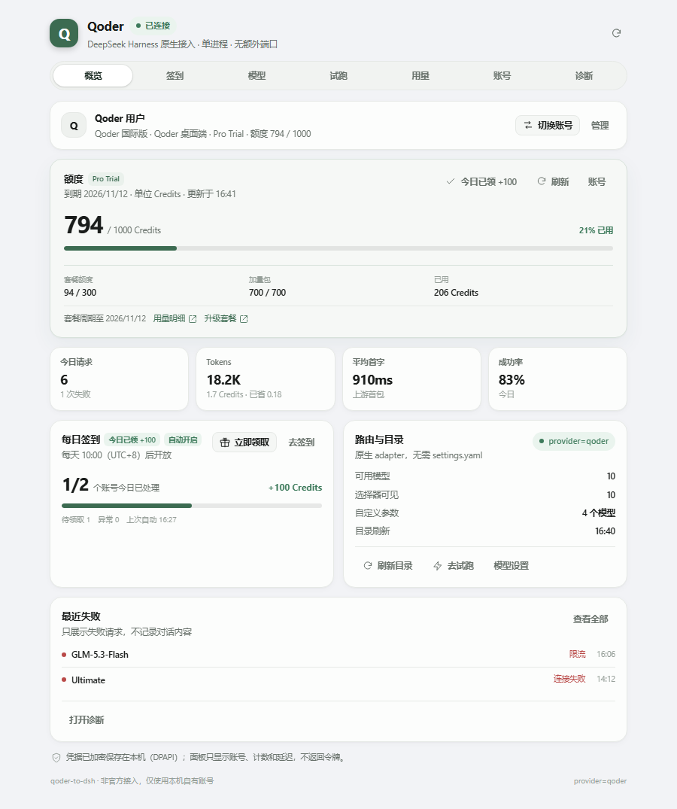
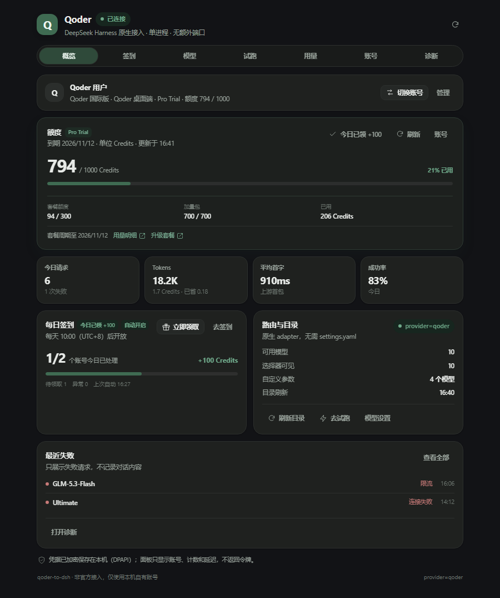
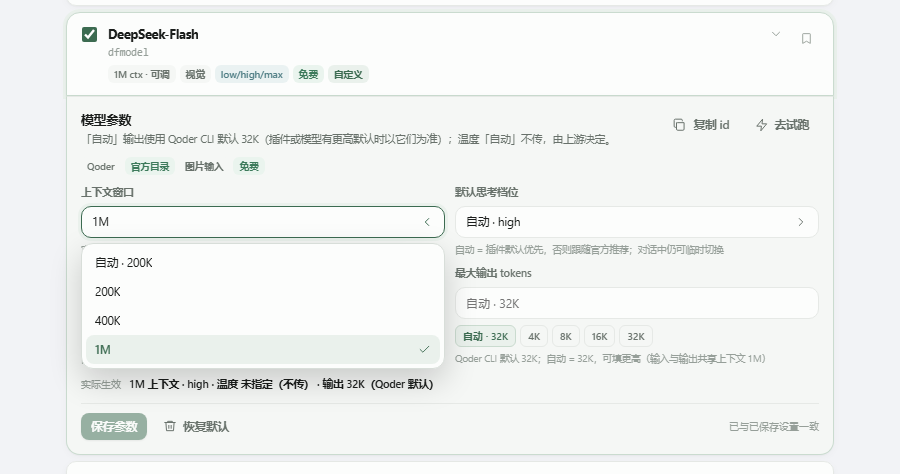
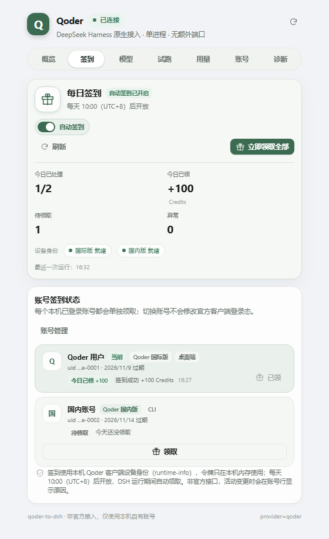
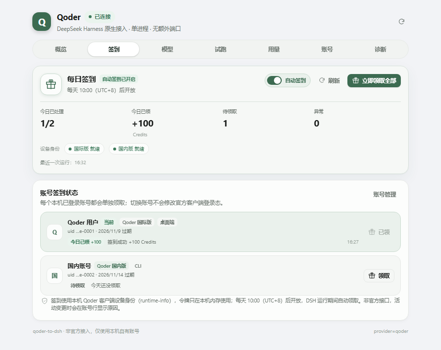
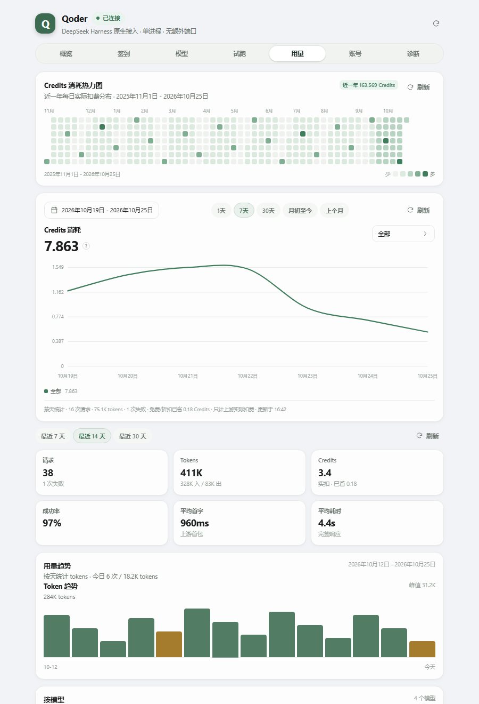

# qoder-to-dsh

把 **Qoder** 的模型额度原生接进 **DeepSeek Harness (DSH)**。当前版本 **1.0.1**。

这是一个纯 DSH 插件：没有本地桥进程，没有第二个端口，没有独立控制台。凭据读取、COSY 签名、模型目录、流式转发和设置面板都在 DSH 插件进程内完成。

> 非官方互操作性实现，只使用你自己合法授权的 Qoder 账号。上游协议可能随时变化。

## 设计

- **单进程**：插件内直接完成认证、目录、请求与面板，不存在“桥在跑但插件连不上”“控制台和请求用的不是同一份令牌”这类状态分裂。
- **原生 provider**：通过 `ctx.llm.registerAdapter(['qoder'], adapter)` 接入，模型直接出现在 DSH 选择器里。
- **同一份数据**：面板、模型选择器和真实请求共享同一份目录、偏好和额度状态。
- **本地优先**：凭据、偏好、用量和日志都保存在本机；面板只返回非敏感元数据。
- **数据驱动**：上下文档位、思考档位、价格倍率来自 Qoder 模型目录；上游新增字段时优先使用上游值。

## 界面

截图使用离线演示数据，不含真实账号信息；主题和窄屏布局跟随 DSH。

<p align="center">
  
  
</p>
<p align="center"><sub>概览：额度、签到、用量与路由状态在同一屏；明亮 / 深色主题一致。</sub></p>

<p align="center">
  
  
</p>
<p align="center"><sub>模型参数：200K / 400K / 1M 上下文档位、自动输出 32K、温度与快捷值；右侧为窄屏签到。</sub></p>

<p align="center">
  
  
</p>
<p align="center"><sub>签到逐账号领取；Credits 只计实际扣费，免费与折扣显示为“已省”。</sub></p>

## 已验证

在 **DSH 0.2.1-rc.3** 实测（`desktop` profile，真实账号）：

- 插件正常加载，设置里出现 **Qoder** 页签；
- 自动只读导入本机 Qoder 桌面端登录态；
- 当前账号模型、上下文档位、思考档位和价格倍率正确显示；
- 真实对话返回 `pong`，`reasoning-delta → text-delta → usage → finish(stop)` 完整；
- 经 DSH 自己的 `llm` 服务以 `provider=qoder` 派发请求也返回 `pong`，模型选择器这条路径真实可用；
- 带 79 次工具调用的历史切换后仍能正常请求，不再触发 `Messages with role 'tool'...`；
- 目录按 `context_config` 显示 200K / 400K / 1M 档位，选中的值会写回请求的 `model_config.max_input_tokens`；
- 免费模型的 `billable: false` 请求不计入实扣，只显示为“已省”；
- 四个只读工具与 `/qoder` 命令注册成功，19 条面板数据路由挂载成功；
- 明亮 / 深色主题跟随 DSH 的 `color-scheme`；
- 每日活动已用真实账号验证：国际版读取到已领取状态，国内版成功领取 Credits；
- 多账号列表能同时看到国际版 / 国内版本机登录，签到结果按账号分别记录。

`tests/live-adapter.mjs` 是协议层实机回归；`tests/verify-install.mjs`（`npm run verify`）是安装面自检；`tests/plugin-host.test.mjs` 用假的 DSH 服务加载真实插件入口，覆盖路由、工具、命令、偏好持久化与未登录保护，不联网。开发时另用本地离线渲染 harness 逐页截图，检查明暗主题、窄屏、失败态、参数保存、试跑取消、键盘与触控。

## 快速开始

### 1. 安装

> **装包 ≠ 启用。** 只写进 profile 的 `dependencies` 时，DSH 不会加载插件，也不会报错；必须同时出现在 `dsh.profile.bundles` 里。

推荐从本地目录安装。在 DSH 里让 agent 执行 `plugin_manager` 的 `install_bundle`：

```text
plugin_manager { action: "install_bundle", target: "/absolute/path/to/qoder-to-dsh" }
```

等价的命令行方式：

```bash
dsh plugin --profile desktop add link:/absolute/path/to/qoder-to-dsh
```

装完确认 profile 的 `package.json` 里同时有依赖和 bundle 选择：

```json
{
  "dependencies": { "qoder-to-dsh": "link:/absolute/path/to/qoder-to-dsh" },
  "dsh": {
    "profile": {
      "bundles": ["@deepseek-ai/dsh-base", "@deepseek-ai/dsh-web-app", "qoder-to-dsh"]
    }
  }
}
```

**装完自检**（只读，不会改动状态）：

```bash
npm run verify              # 连运行中的 dsh 一起检查
npm run verify -- --offline # 只看文件和 profile 配置
```

它会检查「装包 ≠ 启用」、`link:` 是否指向本仓库、patch 里的 name 是否与包名一致、provider 是否注册、模型目录是否为空。任一项 FAIL 就退出码 1。

最后重启 DSH 服务（或重新打开 desktop app）。

### 2. 登录

打开 **设置 → Qoder**。首次使用会自动只读扫描本机 Qoder 桌面端 / CLI 的登录态：

- 有桌面端登录：直接出现账号与模型，无需再次授权；
- 没有：点“浏览器授权”，在打开的 Qoder 页面选择账号；或展开“使用 PAT / 访问令牌”；
- 国内版 / 国际版都支持，可在账号页切换；
- 本机登录了多个账号时，概览右上角可以一键切换当前账号，签到页会列出所有本机账号并分别领取。

凭据保存到 `<DSH_HOME>/qoder/auth.json`：Windows 上用 **DPAPI** 加密；其他平台退回 AES-256-GCM + 本机 0600 密钥文件。

### 3. 使用

在 DSH 模型选择器里选择任意 Qoder 模型。默认 provider 名是 `qoder`，模型 id 就是上游 key（例如 `qmodel_38max`、`auto`、`dmodel`）。

```text
/qoder status
/qoder models
/qoder usage
/qoder checkin [run]
/qoder diagnose
/qoder refresh
/qoder test [model]
/qoder login
/qoder logout
```

模型选择器里可以直接看到每个模型的思考档位（`low/medium/xhigh` 等）、上下文、图片能力和价格倍率。

## 功能

- **原生 provider**：不写 `settings.yaml`，不改 DSH 的模型路由配置。
- **流式对话**：思考内容、正文、工具调用、usage、AbortSignal 全链路透传；首包 45 秒 / 块间空闲 120 秒超时，超时以可见的 `TIMEOUT` 结束，不会无限挂起。
- **工具调用**：DSH 声明的 function tools 原样进入 Qoder 请求；工具结果回灌时剔除孤儿消息与空助手轮。
- **图片**：通过 DSH `attachments.readImage` 转 data URL，交给支持视觉的模型。
- **模型目录**：动态读取 `/algo/api/v2/model/list`；解析 `context_config`、`thinking_config`、`price_factor` 与谷时折扣；面板显示 200K / 400K / 1M 上下文档位、输出默认值、促销与官方标记。
- **模型参数**：每个模型可单独设置上下文窗口、默认思考档位、温度和最大输出，并提供自动 / 0 / 0.3 / 0.7 / 1 与 4K / 8K / 16K / 32K 快捷值。输出「自动」对齐 Qoder 官方 CLI 的 32K 默认；模型声明了输出上限时优先用上限。温度「自动」表示不传 `temperature`，由上游决定。保存后写进 `prefs.json`，DSH 下一次 `listModels` / `stream` 就使用新值，可一键恢复官方默认。
- **账号**：桌面端自动导入、OAuth 设备授权、PAT 导入、令牌自动刷新（`drt-` / `jrt-` / PAT 交换）。
- **额度**：读取上游 `plan` 与 `quota`，显示套餐、加量包、剩余 / 总量、已用比例和到期时间；概览首屏就是额度卡，额度用尽会标红。对话页顶部胶囊也显示当前账号额度，而不是次数 / tokens。
- **每日签到**：读取本机 Qoder 客户端的 `runtime-info` 设备身份，查询 `campaigns` 并领取 `CLAIM_BENEFIT`；支持本机所有已登录账号、自动签到（默认开启）、手动逐账号领取，以及今日已领 / 未开放 / 无活动 / 未下发 / 缺设备 / 需登录等状态。活动每天 10:00（UTC+8）开放，DSH 运行期间对“未下发”和临时错误继续重试；缺设备或登录失效的账号当天不再空转，修好后可手动领取。非激活账号的令牌过期时会只读重读官方登录态，不拿刷新令牌去轮换官方凭据。可用 `QODER_CHECKIN=0` 彻底关闭自动签到。
- **多账号**：账号页首屏直接列出本机桌面端 / CLI 的国际版、国内版账号，概览也可一键展开切换；每个账号显示来源、到期时间和今日签到状态。切换即生效，只改插件，不修改官方客户端登录态。
- **用量**：本地记录请求数、tokens、缓存、推理 tokens、实际扣费 Credits、已省 Credits、首字 / 总耗时和客户端来源；面板支持最近 7 / 14 / 30 天、按模型聚合、成功 / 失败筛选与上游错误详情。只保留元数据，不记录对话内容。
- **Credits 分析**：近 12 个自然月的每日实际扣费热力图；按今天 / 7 天 / 30 天 / 月初至今 / 上个月切换，支持按全部、模型或客户端查看平滑趋势线、悬停明细和图例合计；免费模型不计入消耗，单独显示已省金额。图表支持键盘切换日期与点按查看明细。
- **试跑**：在面板里选择模型、输入 prompt，走真实上游并显示思考过程、回复、usage、首字与总耗时；结果同时计入用量；等待中可随时取消本地等待（上游可能仍完成并计费）。未登录时对话页胶囊可直接发起浏览器授权。
- **诊断**：凭据、令牌、目录、原生路由、存储、偏好、额度、签到设备身份、最近错误与运行环境；日志自动脱敏。
- **面板**：概览 / 签到 / 模型 / 试跑 / 用量 / 账号 / 诊断；低饱和森林绿配色、带水平滑动高亮块的胶囊页签、自绘下拉菜单、账号栏底块、响应式布局，明暗主题跟随 DSH；无渐变、无 emoji、数字等宽，页签切换统一淡入上浮过渡并保留试跑状态，尊重 `prefers-reduced-motion`。首屏不会在状态未返回时误报未登录，读取失败会给出就地重试而不是无限骨架；页签、下拉、分段控件和图表都有键盘路径。
- **斜杠命令 + 4 个只读工具**：agent 可以自己回答“Qoder 现在能不能用、有哪些模型、今天花了多少”。

## 数据与安全

| 文件 | 内容 |
|---|---|
| `<DSH_HOME>/qoder/auth.json` | 加密凭据（DPAPI / AES-GCM）；面板永远不返回令牌 |
| `<DSH_HOME>/qoder/prefs.json` | 模型显示 / 默认 / 上下文 / 参数偏好 |
| `<DSH_HOME>/qoder/checkin.json` | 自动签到开关、各账号最近一次签到结果（不含令牌） |
| `<DSH_HOME>/qoder/usage.json` | 最多 5000 条请求元数据，保留近一年（不含 prompt / 回复；含实扣与已省 Credits） |
| `<DSH_HOME>/qoder/catalog.json` | 模型目录缓存 |
| `<DSH_HOME>/qoder/qoder.log` | 脱敏运行日志 |

安全约束：

- 只读扫描 Qoder 官方客户端文件，不修改官方登录态；
- 不把 access token / refresh token / machineToken 写进日志、面板响应或错误消息；
- 签到结果只保存账号标签、区域、状态和 Credits 数字，不保存任何令牌；
- 桌面端导入的凭据临近过期时，优先只读重读官方存储；只有读不到新令牌时才用 refresh token，避免同一个 `drt-` 的轮换影响官方客户端；
- 写接口要求 `x-qoder-panel: 1`（自定义头触发 CORS 预检，挡掉跨站简单请求）；
- 不新增监听端口；所有面板数据走 DSH 自己的 loopback Web 载体；
- 不内置任何密钥、账号或额度；COSY 公钥来自 Qoder 公开客户端协议，仅用于互操作。

## 已知限制

- **非官方路径**：Qoder 可能修改签名、模型 key 或上游 schema；失效时先看「诊断」页。
- **单激活账号**：模型请求始终使用当前激活的一个账号；支持在本机已登录的国际版 / 国内版账号之间切换，并会对所有本机账号执行每日签到；不做多账号池化、负载均衡、代他人调用、转售或托管。
- **试跑会花额度**：面板的试跑和 `/qoder test` 都是真实上游请求，会计入用量与 Credits；只是验证链路时用最小 prompt。取消只停止本地等待，上游可能仍会完成这次请求。
- **Credits 按上游实扣统计**：以 `usage.billable` 为准。Qoder 对免费模型也会返回原价 `credits`（`billable: false`），这部分显示为“已省”，不计入消耗；折扣请求同样只记实扣。旧版本留下的免费模型记录会按当前目录的免费标记只读修正统计，不改写原始 usage 文件。
- **上下文档位以 Qoder 的 `context_config` 为准**：DeepSeek-V4-Flash / Pro、Qwen3.8-Max 等模型提供 200K / 400K / 1M。旧版本误用 `max_input_tokens` 把档位砍成 180K / 96K，已修正；选择 1M 会写回请求的 `model_config.max_input_tokens`。上游仍可能按账号或网关策略截断，超长上下文请以诊断页和实际响应为准。
- **工具调用历史**：assistant 的 `tool_calls` 统一带空字符串 `content`（Qoder 网关不接受 `null`，否则会误报 `Messages with role 'tool'...`）；带工具调用的历史也能继续复用。
- **模型参数是本地偏好**：上下文窗口 / 思考档位 / 温度 / 最大输出只影响本插件发给上游的请求与 DSH 选择器，不会修改 Qoder 官方客户端设置；上游仍可能按自己的模型上限拒绝或截断。输出「自动」是 32K（Qoder 官方 CLI 默认），可手动调高；温度没有公开的聊天默认值，插件不猜。
- **签到也是非官方接口**：使用本机 Qoder 客户端 `runtime-info` 生成的设备身份，活动每天 10:00（UTC+8）后开放；平台可能调整活动或风控。自动签到默认开启，可在「签到」页关闭，或用 `QODER_CHECKIN=0` 禁用；DSH 没运行时不会签到。没有活动时会明确显示「无活动」或「未开放」，不会混进待领取或异常；缺设备 / 需登录的账号当天不自动重试。
- **超时是本地判定**：首包默认 45 秒、块间空闲默认 120 秒；可通过插件配置 `firstByteTimeoutMs` / `streamIdleTimeoutMs` 调整（0 表示不限）。超时只会停止本地等待，已经发出的上游请求仍可能产生少量 Credits。
- **多账号只切换插件**：账号来自本机官方客户端的只读扫描；切换只改插件当前使用的账号，不会写入或退出官方客户端。
- **协议**：当前使用已实测的 COSY + `agent_chat_generation` 路径；更新版 Bearer 端点存在但模型 id 体系不同，未作为默认路径。
- **设备授权 / PAT**：协议流程已实现，离线回归覆盖 PAT、设备授权与过期令牌重试；本次实机验证主要走桌面端导入，欢迎用真实 PAT 补一次实机回归。
- **图片 / 工具调用**：取决于上游模型与账号能力；失败会以可见错误结束，不会伪造成功。
- **Windows 凭据导入**依赖 PowerShell DPAPI；无 PowerShell 的精简环境会退回 AES 本地密钥模式（仍不落明文 token）。

## 开发

```bash
npm test                 # 纯函数 / 流翻译 / 流超时与失败统计 / 客户端缓存与登录 / 状态 / 签到 / Credits / 宿主路由
npm run check            # 所有模块语法检查
npm run verify           # 安装自检：文件 / profile / 运行态（只读）
npm run test:live        # 实机回归：会真实调用一次 Qoder（消耗少量 Credits）
```

第三方许可与归属信息见 [NOTICE.md](NOTICE.md)。

## License

MIT。Qoder、DeepSeek Harness 及相关商标归各自所有者；本项目与官方无隶属关系。
